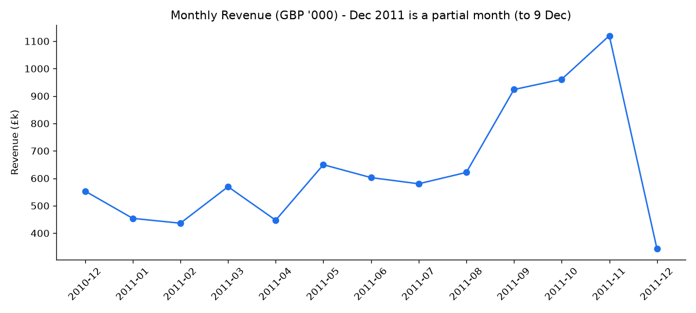
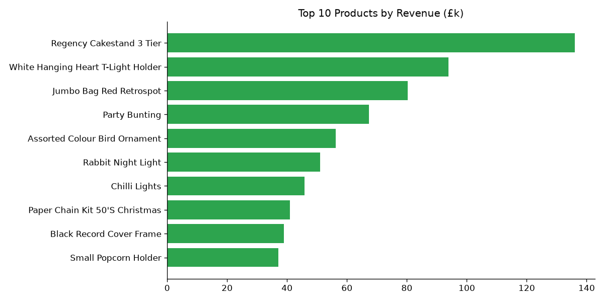
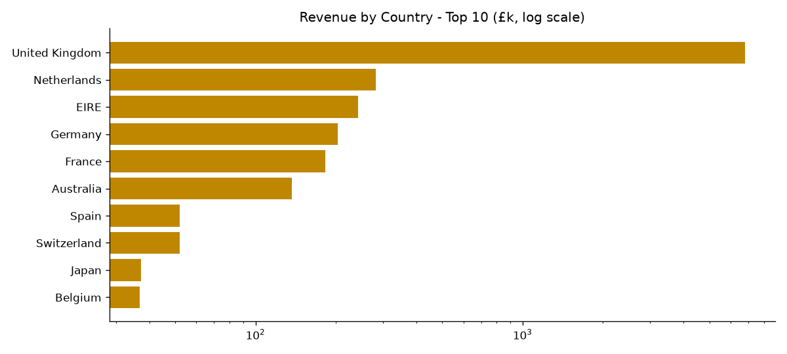
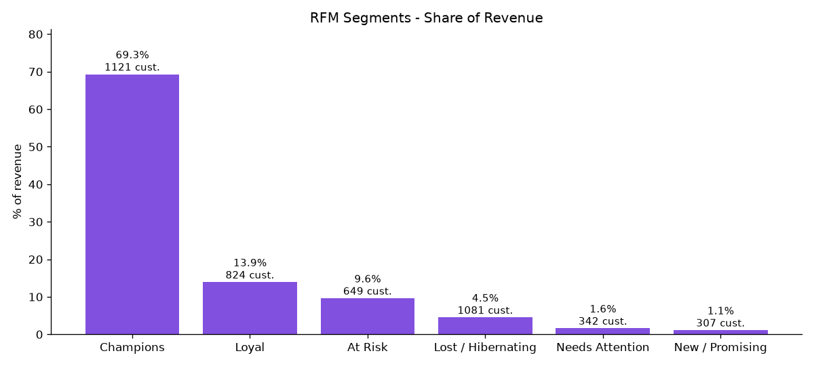

# Retail Sales Analysis with SQL, Excel & Python

An end-to-end analysis of **541,909 real e-commerce transactions** from a UK online gift retailer (Dec 2010 to Dec 2011). I validate and clean the data in SQL, build KPIs, and segment customers with RFM. The results go into an Excel summary workbook and a set of charts.

## Business problem
The retailer wants answers to these questions:
1. How much revenue are we making, and how is it trending month to month?
2. Which products and customers drive the business?
3. How concentrated is revenue by customer and country?
4. Which customers are loyal, which are at risk, and which have been lost?

Before any of that, the data must be **trustworthy**. Data validation and reconciliation is my professional background, so the project starts there.

## Dataset
- **Online Retail** dataset, UCI Machine Learning Repository (Daqing Chen, 2015)
- Source: https://archive.ics.uci.edu/dataset/352/online+retail (direct file: https://archive.ics.uci.edu/static/public/352/online+retail.zip)
- License: **Creative Commons Attribution 4.0 (CC BY 4.0)**
- `data/online_retail.csv.gz` holds the **full** dataset, converted from the original `.xlsx` to a gzipped CSV (about 7.6 MB) so it fits on GitHub. No rows were removed.
- Columns: InvoiceNo, StockCode, Description, Quantity, InvoiceDate, UnitPrice (GBP), CustomerID, Country

## Approach
1. Load the raw CSV into SQLite as `raw_sales` (`scripts/analysis.py`)
2. **`sql/01_data_cleaning_and_validation.sql`**: null checks, duplicates, cancellations and returns, price checks, type and date checks, value reconciliation, then build the clean `sales` table
3. **`sql/02_kpis.sql`**: revenue, orders, customers, AOV, monthly trend with MoM growth (window function `LAG`), weekday and hour patterns
4. **`sql/03_customer_product_analysis.sql`**: top products and customers, country split, RFM segmentation (`NTILE` quintiles), repeat rate, revenue concentration
5. Export to `excel/retail_sales_summary.xlsx` (KPI sheet, monthly trend with a line chart, top-10 tables with a bar chart, RFM) and to `images/`

## Data-quality checks (actual results)
| Check | Result |
|---|---|
| Total raw rows | 541,909 |
| Missing CustomerID | 135,080 rows (24.9%) |
| Missing Description | 1,454 |
| Exact duplicate rows | 5,268 |
| Cancellation lines (Invoice starts with "C") | 9,288 |
| Non-positive quantity lines | 10,624 (1,336 of them are *not* flagged as cancellations, i.e. stock adjustments) |
| Zero-price / negative-price lines | 2,515 / 2 |
| Non-product codes (postage, fees, manual adjustments) | 2,916 |
| Unparseable dates / non-integer quantities | 0 / 0 |
| Reconciliation: gross sales vs cancelled value | £10,644,560 gross vs £896,812 cancelled (about 8.4%) |
| Sale lines later fully reversed by a matching cancellation (same customer, product, qty) | 4,101 lines worth £500,918, removed so that cancelled orders don't inflate sales |
| **Clean rows kept** | **387,230 (71.5%)**, with 154,679 removed |

All KPIs below use the clean table: valid customer, positive quantity and price, no cancellations or reversed sales, no duplicates, products only.

## Key insights
- **£8.26M net revenue** from **18,247 orders** and **4,324 customers**, with an **average order value of £452.74**.
- **Strong Q4 seasonality.** Monthly revenue climbed from £436K (Feb 2011) to a peak of **£1.12M in Nov 2011**. Sep 2011 grew **+48.7% MoM**. Dec 2011 looks lower only because the data ends on 9 Dec.
- **Revenue is highly concentrated.** The **top 10% of customers bring 59.9% of revenue**. The RFM "Champions" segment (1,121 customers) accounts for **69.3%**, while **649 "At Risk" customers** (about 150 days since their last order, 3.4 orders on average) still hold 9.6%, which makes them a clear win-back target.
- **The UK is 82.3% of revenue** (£6.80M). The Netherlands (3.4%) and EIRE (2.9%) come next, each from only 9 and 3 customers respectively (wholesale-style accounts).
- **65.2% of customers are repeat buyers.** Thursday is the busiest day (£1.90M), there are **no Saturday orders**, and sales peak between 10:00 and 15:00. The top product is the *Regency Cakestand 3 Tier* (£136K).
- **Reconciliation changed the answer.** Before matching cancellations to their original sales, the "top product" was *Paper Craft, Little Birdie* (£168K). That turned out to be a single 80,995-unit order cancelled minutes later. Matching the cancellations removed £500,918 of reversed sales that a simple filter would have counted.






## How to run
```bash
pip install pandas openpyxl matplotlib
python scripts/analysis.py
```
The script loads the data into an in-memory SQLite database and runs the three SQL files in order. It prints every result, then regenerates the Excel workbook and the charts. The SQL is standard SQLite (CTEs and window functions), so you can also run it in DB Browser for SQLite after loading the CSV as `raw_sales`.

## Skills demonstrated
SQL (CTEs, window functions `LAG` and `NTILE`, aggregation, CASE), data validation and reconciliation, data cleaning, KPI design, cohort-style customer segmentation (RFM), Excel reporting with native charts, Python (pandas, matplotlib, openpyxl), and business storytelling.

## Repository structure
```
data/online_retail.csv.gz        full raw dataset (CC BY 4.0)
sql/01_data_cleaning_and_validation.sql
sql/02_kpis.sql
sql/03_customer_product_analysis.sql
scripts/analysis.py              reproduces everything
excel/retail_sales_summary.xlsx  summary workbook
images/*.png                     charts
```

---
**Author: Vasanth M**, Data Analyst, Bengaluru · [GitHub](https://github.com/Fjiolla-Fjj)
